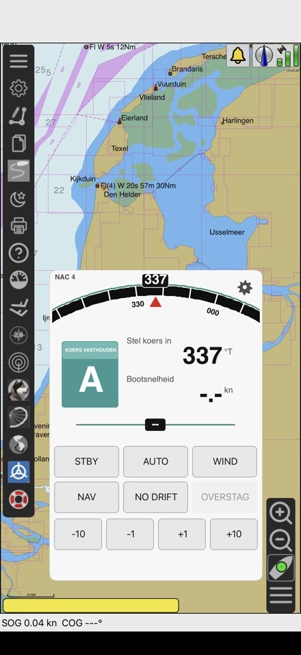

# OpenCPN for iOS

An unofficial port of [OpenCPN](https://opencpn.org) 5.14.2 to iPhone and iPad.

The app is the regular OpenCPN chart plotter, built for iOS with wxWidgets 3.3 on Qt 6. That
is the same route as the Android version of OpenCPN. The screens follow the desktop version,
adapted for touch and small screens. Plugins are built into the app, because iOS does not
allow apps to load them at runtime.

> **Made with Claude Code.** This port was developed by Xander Burchartz together with
> [Claude Code](https://claude.com/claude-code), Anthropic's AI coding assistant. Claude wrote
> most of the code and patches, under Xander's direction. Xander tested the app on his own
> iPhone, iPad and boat. Please keep this in mind when reviewing the code.

  
  
  
  

## Status: alpha

This is an early version. Do not use it as your only means of navigation.

Not all plugins are well tested. What has been checked so far:

- Checked on iPhone and iPad: chart display, AIS and NMEA input, dashboard, chart
  downloader, GRIB, WMM, watchdog, polar, radar, o-charts and the autopilot plugins. The
  Navico autopilot plugin works from the device.
- Partly checked: weather routing.
- Hardly tested yet: VDR, tactics, pypilot and autopilot route.
- o-charts: encrypted o-charts charts do not work, because the decryption service is not
  included.

Tested on an iPhone 17 Pro Max with iOS 26.6 and an iPad Pro 12.9-inch (4th generation)
with iPadOS 26.5. The app requires iOS or iPadOS 18 or newer.

Please report what does and does not work for you under Issues in this repository, not to
the OpenCPN project.

## What is included

- OpenCPN 5.14.2 with vector charts (S-57 ENC, CM93) and the built-in basemap.
- Data input over the network (NMEA 0183, AIS, and NMEA 2000 through a network gateway)
  and from the built-in GPS of the device.
- Plugins: dashboard, GRIB, WMM, chart downloader, radar, weather routing, watchdog, VDR,
  polar, tactics, Raymarine autopilot, Navico autopilot, pypilot, autopilot route and
  o-charts.
- Charts, GRIB files, logs and screenshots are stored in the app's own folder, visible in
  the Files app as "On My iPhone › OpenCPN".

## Getting the app

For now you build it yourself with a Mac and Xcode, and install it on your own device with a
free Apple ID: see [docs/building.md](docs/building.md). Distribution through
TestFlight is planned.

## Repository layout

| folder | contents |
|---|---|
| `app/` | iOS-specific code: app window, touch handling, file picker, OpenGL ES layer, plugin registration |
| `patches/` | changes to OpenCPN, wxWidgets and the plugins, applied by `scripts/apply-patches.sh` |
| `scripts/` | fetching the third-party source, building, signing |
| `cmake/`, `app/cmake/` | build configuration |
| `spikes/` | small test programs from the start of the port |
| `docs/` | build guide, licence notes, o-charts notes |

Third-party source is not stored here. `scripts/fetch-upstream.sh` downloads every component
at a fixed commit into `upstream/`; builds go into `build/`. Most comments in the code and the
script messages are in Dutch.

## Licence

The app as a whole is distributed under the GNU General Public License, version 3: see
[LICENSE](LICENSE). [COPYRIGHT.md](COPYRIGHT.md) lists the components and their licences.

This port is not an official OpenCPN release. The OpenCPN project and the plugin authors are
not responsible for it.
