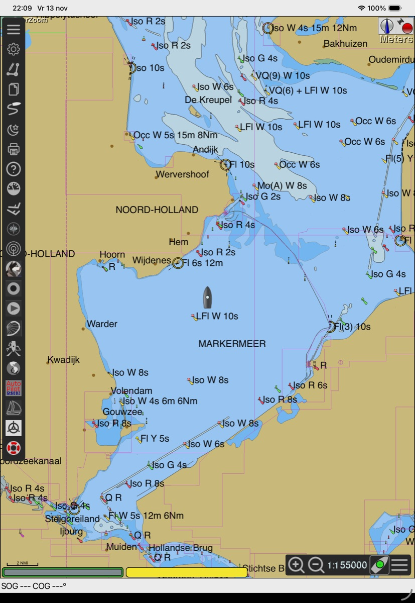
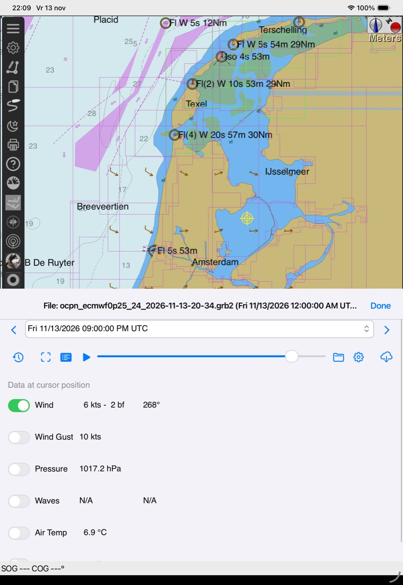
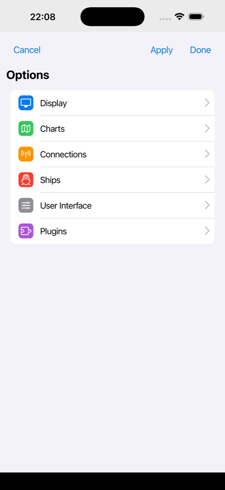

# OpenCPN for iOS

An unofficial port of [OpenCPN](https://opencpn.org) 5.14.2 to iPhone and iPad.

The app is the regular OpenCPN chart plotter, built for iOS with wxWidgets 3.3 on Qt 6. That
is the same route as the Android version of OpenCPN. The screens follow iOS: the toolbar, the
compass and GPS box, the zoom buttons and the SOG/COG box are drawn in iOS style, Options
works like the iOS Settings app, and dialogs open as sheets that fit the screen. On an iPad
with a trackpad, and in the iPad app on a Mac, you scroll with two fingers and pinch to zoom.
Plugins are built into the app, because iOS does not allow apps to load them at runtime. After
a fresh install all plugins are off; turn them on under Options › Plugins.

> **Made with Claude Code.** This port was developed by Xander Burchartz together with
> [Claude Code](https://claude.com/product/claude-code), Anthropic's AI coding assistant. Claude wrote
> most of the code and patches, under Xander's direction. Xander tested the app on his own
> iPhone, iPad and boat. Please keep this in mind when reviewing the code.

  
  
  
  

## Status: alpha

This is an early version. Not all plugins are well tested. What has been checked so far:

- Checked on iPhone and iPad: chart display, AIS and NMEA input, dashboard, chart
  downloader, GRIB, WMM, watchdog, polar, radar (radar_pi), o-charts and the autopilot
  plugins. The Navico autopilot plugin works from the device.
- Partly checked: weather routing.
- Hardly tested yet: VDR, tactics, pypilot and autopilot route.
- New and not yet tested with a real radar: mayara_pi.
- o-charts: encrypted o-charts charts do not work, because the decryption service is not
  included.

Tested on an iPhone 17 Pro Max with iOS 26.6 and an iPad Pro 12.9-inch (4th generation)
with iPadOS 26.5. The app requires iOS or iPadOS 18 or newer.

Please report what does and does not work for you under Issues in this repository, not to
the OpenCPN project.

## What is included

- OpenCPN 5.14.2 with vector charts (S-57 ENC, CM93) and the built-in basemap.
- Data input over the network (NMEA 0183, AIS, and NMEA 2000 through a network gateway)
  and from the built-in GPS of the device.
- Plugins: dashboard, GRIB, WMM, chart downloader, radar (radar_pi), weather routing,
  watchdog, VDR, polar, tactics, Raymarine autopilot, Navico autopilot, pypilot, autopilot
  route and o-charts.
- [mayara_pi](https://github.com/opencpn-radar-pi/mayara_pi): radar picture and radar overlay
  on the chart from a [mayara-server](https://github.com/MarineYachtRadar/mayara-server)
  elsewhere on the network. You enter the server address, or the app looks for the server with
  Bonjour. The server itself does not run on iOS.
- The TestFlight build has Apple's multicast entitlement, which iOS requires for network
  sources that use UDP broadcast or multicast and for Signal K discovery.
- Charts, GRIB files, logs and screenshots are stored in the app's own folder, visible in
  the Files app as "On My iPhone › OpenCPN".

## Getting the app

The app is available as an unofficial beta on TestFlight:
[testflight.apple.com/join/RFM5evw4](https://testflight.apple.com/join/RFM5evw4). Install
Apple's TestFlight app first, then open the link on your iPhone, iPad or Mac. The current
build is build 9; what changed per build is in [CHANGELOG.md](CHANGELOG.md). Please send
feedback through the TestFlight app.

You can also build it yourself with a Mac and Xcode, and install it on your own device with a
free Apple ID: see [docs/building.md](docs/building.md).

## Repository layout

| folder | contents |
|---|---|
| `app/` | iOS-specific code: app window, touch handling, file picker, OpenGL ES layer, plugin registration |
| `patches/` | changes to OpenCPN, wxWidgets and the plugins, applied by `scripts/apply-patches.sh` |
| `scripts/` | fetching the third-party source, building, signing |
| `cmake/`, `app/cmake/` | build configuration |
| `spikes/` | small test programs from the start of the port |
| `docs/` | build guide, licence notes, o-charts notes |

Third-party source is not stored here. `scripts/fetch-upstream.sh` downloads every component
at a fixed commit into `upstream/`; builds go into `build/`. The script messages and most code
in `app/` are in Dutch.

## The changes to OpenCPN

The changes to OpenCPN itself are kept as a series of small commits, each about one subject and
each with an English explanation. They live in a fork of OpenCPN,
[xanderburchartz/OpenCPN](https://github.com/xanderburchartz/OpenCPN), on two branches:

- [`ios-port`](https://github.com/xanderburchartz/OpenCPN/tree/ios-port): the series on top
  of OpenCPN `master`. This is where the work happens and what is offered for review.
- [`ios-port-5.14.2`](https://github.com/xanderburchartz/OpenCPN/tree/ios-port-5.14.2): the
  same commits on the OpenCPN 5.14.2 release. The app is built from this branch.

The same release series is in `patches/OpenCPN/` as `git format-patch` files, so that
`scripts/apply-patches.sh` can rebuild the source tree from a plain OpenCPN checkout. Fixes that
are not specific to iOS go to OpenCPN as separate pull requests:
[#5550](https://github.com/OpenCPN/OpenCPN/pull/5550),
[#5551](https://github.com/OpenCPN/OpenCPN/pull/5551),
[#5553](https://github.com/OpenCPN/OpenCPN/pull/5553),
[#5554](https://github.com/OpenCPN/OpenCPN/pull/5554) and
[#5555](https://github.com/OpenCPN/OpenCPN/pull/5555). The first one is also in
`patches/OpenCPN-fixes/n2k-126996-request-backoff/`.

## Licence

The app as a whole is distributed under the GNU General Public License, version 3: see
[LICENSE](LICENSE). [COPYRIGHT.md](COPYRIGHT.md) lists the components and their licences.

This port is not an official OpenCPN release. The OpenCPN project and the plugin authors are
not responsible for it.
